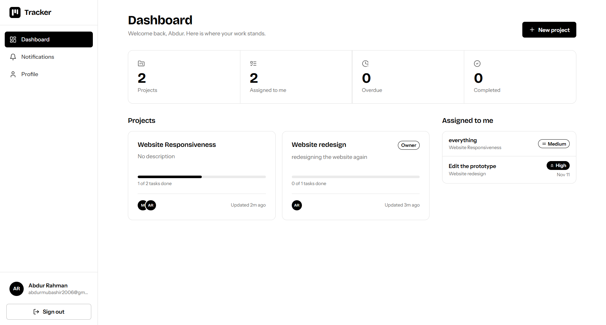
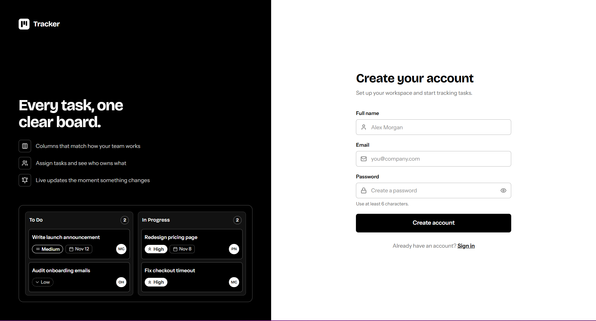
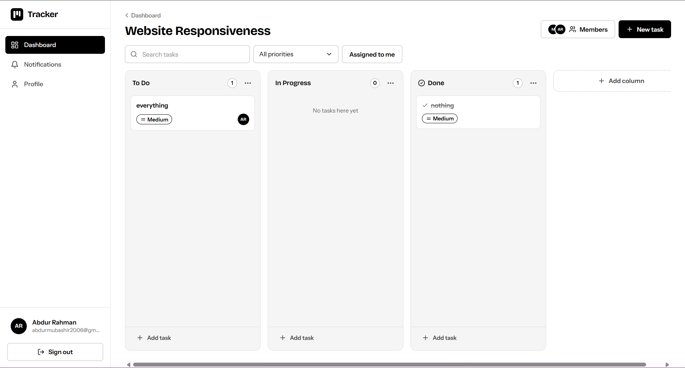
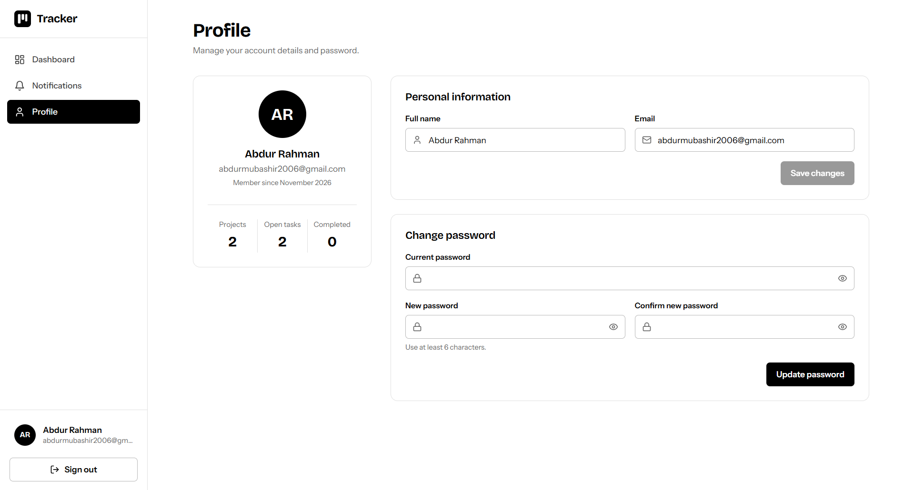
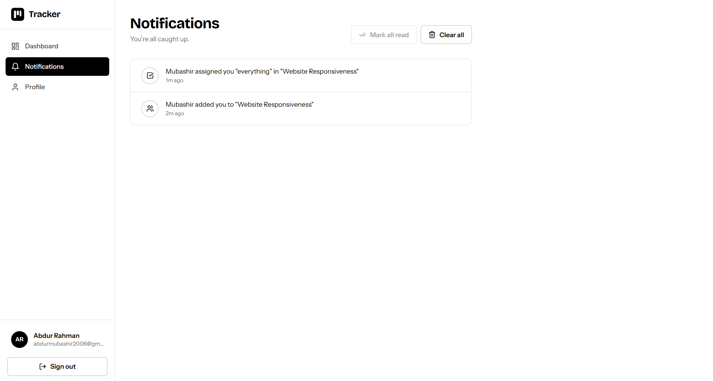

# 📋 Project Management Application

A full-stack collaborative project management application inspired by **Trello and Asana**, designed to help users organize projects, manage tasks, track progress, and collaborate with other team members.

The application provides a centralized workspace where users can create projects, manage Kanban boards, organize tasks, and communicate through task comments.

Built using **Node.js, Express.js, MongoDB, HTML, CSS, and JavaScript**, with JWT authentication and Socket.IO for real-time collaboration.

### 📊 Dashboard



---

## ✨ Features

### 🔐 Authentication System

- User registration
- User login
- JWT-based authentication
- Password hashing using bcrypt
- Protected API routes
- Token-based session authentication
- Current user profile retrieval
- Logout functionality (frontend)

### 📊 Dashboard

- Personalized user dashboard
- View all accessible projects
- Create new projects
- Open existing projects
- Delete projects
- Project ownership
- Project membership foundation

### 📁 Project Management

- Create projects
- View all user projects
- Delete projects
- Project ownership system
- Project members
- Default project columns
- User-specific project access foundation

### 📌 Kanban Task Board

- Three default task columns:
  - To Do
  - In Progress
  - Done
- Create tasks
- Display tasks by project
- Update task status
- Move tasks between columns through API
- Delete tasks
- Project-based task organization

### 📝 Task Cards

Each task supports:

- Task title
- Task description
- Task status
- Associated project
- Assigned user field
- Creation timestamp
- Last updated timestamp

### 💬 Task Comments

- Add comments to tasks
- View task comments
- Associate comments with users
- Associate comments with tasks
- Display commenter information
- Comment timestamps
- Chronological comment history

### 🔔 Notifications

- In-app notification system
- Notification storage in MongoDB
- Task creation notifications
- Comment notifications
- User-specific notification delivery
- Read/unread notification status
- Real-time notification delivery through Socket.IO

### ⚡ Real-Time Collaboration

- Socket.IO integration
- WebSocket-based communication
- Project-based socket rooms
- User-specific socket rooms
- Real-time task creation events
- Real-time task update events
- Real-time task deletion events
- Live comment events
- Instant notification events
- Automatic board synchronization without manual page refresh

### 📱 Responsive Design

- Responsive layouts
- Mobile-friendly interface
- Tablet support
- Desktop layouts
- Flexible dashboard layout
- Responsive Kanban board

---

## 🛠️ Tech Stack

### Frontend

- HTML5
- CSS3
- JavaScript (Vanilla JS)
- Fetch API
- Local Storage
- Socket.IO Client

### Backend

- Node.js
- Express.js
- REST API
- MongoDB
- Mongoose
- JWT Authentication
- bcryptjs
- dotenv
- CORS
- Socket.IO

### Database

**MongoDB** is used as the primary database, with Mongoose for schema definition, validation, and database operations.

Collections:

- Users
- Projects
- Tasks
- Comments
- Notifications

### Real-Time Communication

**Socket.IO**

Used to establish real-time communication between connected users through project-specific and user-specific rooms.

---

## 📂 Project Structure

```text
project-management-app/
│
├── backend/
│   │
│   ├── config/
│   │   └── db.js
│   │
│   ├── controllers/
│   │   ├── authController.js
│   │   ├── projectController.js
│   │   ├── taskController.js
│   │   └── commentController.js
│   │
│   ├── middleware/
│   │   └── authMiddleware.js
│   │
│   ├── models/
│   │   ├── User.js
│   │   ├── Project.js
│   │   ├── Task.js
│   │   ├── Comment.js
│   │   └── Notification.js
│   │
│   ├── routes/
│   │   ├── authRoutes.js
│   │   ├── projectRoutes.js
│   │   ├── taskRoutes.js
│   │   └── commentRoutes.js
│   │
│   ├── sockets/
│   │   └── socket.js
│   │
│   ├── utils/
│   │   ├── generateToken.js
│   │   └── createNotification.js
│   │
│   ├── .env
│   ├── .gitignore
│   ├── server.js
│   └── package.json
│
├── frontend/
│   │
│   ├── css/
│   │   └── styles.css
│   │
│   ├── js/
│   │   ├── api.js
│   │   ├── auth.js
│   │   ├── dashboard.js
│   │   ├── project.js
│   │   └── socket.js
│   │
│   ├── pages/
│   │   ├── login.html
│   │   ├── register.html
│   │   ├── dashboard.html
│   │   └── project.html
│   │
│   └── index.html
│
└── README.md
```

---

## 📄 Application Pages

| Page | Purpose |
|---|---|
| Home | Welcome page and application introduction |
| Login | User authentication |
| Register | New user registration |
| Dashboard | View and manage projects |
| Project Board | Manage project tasks through Kanban columns |

---

## 🧭 Application Flow

The application follows a straightforward workflow, allowing users to move from authentication to project management and collaboration.

```text
Welcome Page
     ↓
Login / Register
     ↓
User Dashboard
     ↓
Create / Select Project
     ↓
Project Board
     ↓
Create Task Cards
     ↓
Move Tasks Between Columns
     ↓
Task Details & Comments
     ↓
Notifications & Real-Time Updates
```

The main goal is to provide:

> Secure Authentication → Project Organization → Task Management → Team Collaboration → Real-Time Synchronization.

---

## 🔌 API Structure

The backend follows a RESTful API architecture.

### Authentication Routes

| Method | Endpoint | Description |
|---|---|---|
| POST | `/api/auth/register` | Register a new user |
| POST | `/api/auth/login` | Authenticate user |
| GET | `/api/auth/me` | Get current user |

### Project Routes

| Method | Endpoint | Description |
|---|---|---|
| POST | `/api/projects` | Create project |
| GET | `/api/projects` | Get user projects |
| DELETE | `/api/projects/:id` | Delete project |

### Task Routes

| Method | Endpoint | Description |
|---|---|---|
| POST | `/api/tasks` | Create task |
| GET | `/api/tasks/:projectId` | Get project tasks |
| PUT | `/api/tasks/:id` | Update task status |
| DELETE | `/api/tasks/:id` | Delete task |

### Comment Routes

| Method | Endpoint | Description |
|---|---|---|
| POST | `/api/comments` | Add task comment |
| GET | `/api/comments/:taskId` | Get task comments |

### Socket.IO Events

| Event | Purpose |
|---|---|
| `joinProject` | Join a project room |
| `joinUser` | Join a user-specific room |
| `taskCreated` | Broadcast new task |
| `taskUpdated` | Broadcast task changes |
| `taskDeleted` | Broadcast task deletion |
| `commentAdded` | Broadcast new comment |
| `notification` | Deliver notifications |

---

## 📊 Current Project Status

### Backend

- [x] Node.js setup
- [x] Express server configuration
- [x] MongoDB connection
- [x] Mongoose models
- [x] User registration
- [x] User login
- [x] Password hashing
- [x] JWT authentication
- [x] Authentication middleware
- [x] Protected API routes
- [x] Project CRUD foundation
- [x] Task creation and retrieval
- [x] Task status updates
- [x] Task deletion
- [x] Comment system
- [x] Socket.IO server setup
- [x] Project-based socket rooms
- [x] Notification model
- [x] Notification creation helper

### Frontend

- [x] HTML structure
- [x] CSS styling foundation
- [x] JavaScript functionality
- [x] Welcome page
- [x] Login page
- [x] Registration page
- [x] Dashboard
- [x] Project listing
- [x] Project creation
- [x] Kanban board layout
- [x] Task creation
- [x] Task display
- [x] API integration foundation
- [x] Socket.IO client setup foundation

### Remaining Improvements

- [ ] Complete end-to-end frontend authentication testing
- [ ] Add frontend logout and session handling
- [ ] Implement task editing
- [ ] Add task details modal
- [ ] Integrate comments into task UI
- [ ] Build a notification dropdown/panel
- [ ] Add notification read/unread functionality
- [ ] Complete live UI synchronization
- [ ] Add drag-and-drop task management
- [ ] Implement project member invitations
- [ ] Add task assignment interface
- [ ] Improve form validation and error handling
- [ ] Improve responsive UI
- [ ] Add loading and empty states
- [ ] Perform security and authorization testing

---

## 🔮 Future Development

The application is designed to evolve into a more complete collaborative project management platform.

### Project Collaboration

Future improvements may include:

- Invite members to projects
- Remove project members
- Assign tasks to team members
- Display project members
- Track individual task contributions
- Project activity history

### Advanced Task Management

- Drag-and-drop Kanban cards
- Task priorities (Low, Medium, High)
- Due dates and deadlines
- Task editing
- Task labels and categories
- Task filtering and searching
- Task activity history
- Subtasks and checklists

### Advanced Notifications

- Notification dropdown
- Mark notifications as read
- Mark all notifications as read
- Notifications for task assignments
- Notifications for comments
- Notifications for project invitations

### Dashboard Analytics

- Total projects
- Total tasks
- Completed tasks
- Pending tasks
- In-progress tasks
- Task completion percentage
- Project activity overview

### Security Improvements

- Stronger input validation
- Role-based authorization
- Project membership verification
- Secure socket authentication
- Rate limiting
- Improved token and session handling

---

## 🚀 Getting Started

### Prerequisites

Make sure you have installed:

- Node.js
- npm
- MongoDB (local installation or MongoDB Atlas)
- Git

### Clone the Repository

```bash
git clone YOUR_GITHUB_REPOSITORY_URL
```

### Navigate to the Project

```bash
cd project-management-app
```

### Backend Setup

```bash
cd backend
npm install
```

### Environment Variables

Create a `.env` file inside the backend directory.

```env
PORT=5000
NODE_ENV=development
MONGO_URI=your_mongodb_connection_string
JWT_SECRET=your_secret_key
JWT_EXPIRES_IN=7d
CLIENT_URL=http://127.0.0.1:5500
```

### Start Backend Server

```bash
npm run dev
```

The backend API will run at:

```text
http://localhost:5000
```

### Frontend Setup

Open the frontend using VS Code Live Server or another static development server.

For example:

```text
http://127.0.0.1:5500
```

Make sure the frontend origin matches `CLIENT_URL` in your backend environment configuration.

---

## 📸 Screenshots

Add your application screenshots here after completing the UI.


### 🔐 Login


### 🔐 Register



### 📌 Task Board



### 👤 Profile



### 🔔 Notifications



---

## 🎯 Project Goals

The application is designed to provide a simple but effective workspace for individuals and teams.

The main goals are:

- Simplify project organization
- Improve task management
- Track project progress
- Encourage team collaboration
- Provide a centralized task management system
- Enable real-time communication
- Reduce manual project updates
- Create an intuitive Kanban workflow
- Provide a scalable foundation for future features

---

## 🧠 What I Learned

Through this project, I aim to strengthen my understanding of:

- Building RESTful APIs with Express.js
- Designing MongoDB schemas with Mongoose
- Implementing JWT authentication
- Password hashing and authentication security
- Middleware and protected routes
- CRUD operations
- Managing relationships between MongoDB collections
- Frontend and backend integration
- JavaScript Fetch API
- Real-time communication using Socket.IO
- WebSocket-based event handling
- Room-based communication
- Collaborative application architecture
- Structuring a scalable full-stack project

---

## 📌 Project Status

**Frontend: Basic implementation completed / Integration and polishing ongoing**

**Backend: Core API foundation implemented**

**Authentication: Implemented**

**Project & Task Management: Core functionality implemented**

**Comments: Backend functionality implemented**

**Notifications: Backend foundation implemented / UI integration pending**

**Real-Time Collaboration: Socket.IO foundation implemented / End-to-end testing pending**

**Advanced Features: Planned**

---

## 📬 Contact

If you like this project or would like to collaborate:

- GitHub: https://github.com/abdurrah0006
- LinkedIn: https://linkedin.com/in/abdurrah0006

---

## ⭐ Give a Star

If you find this project useful or interesting, consider giving the repository a ⭐.
